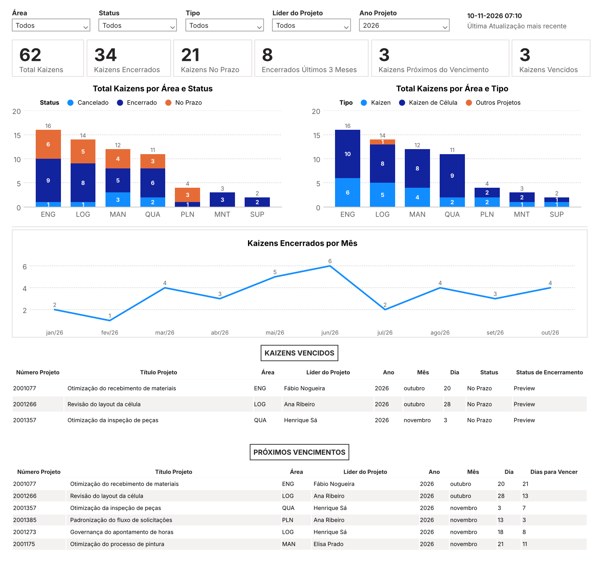
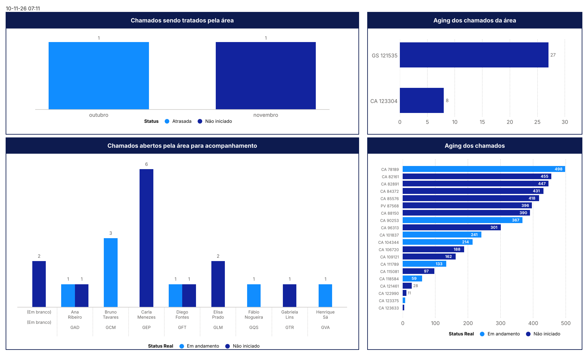
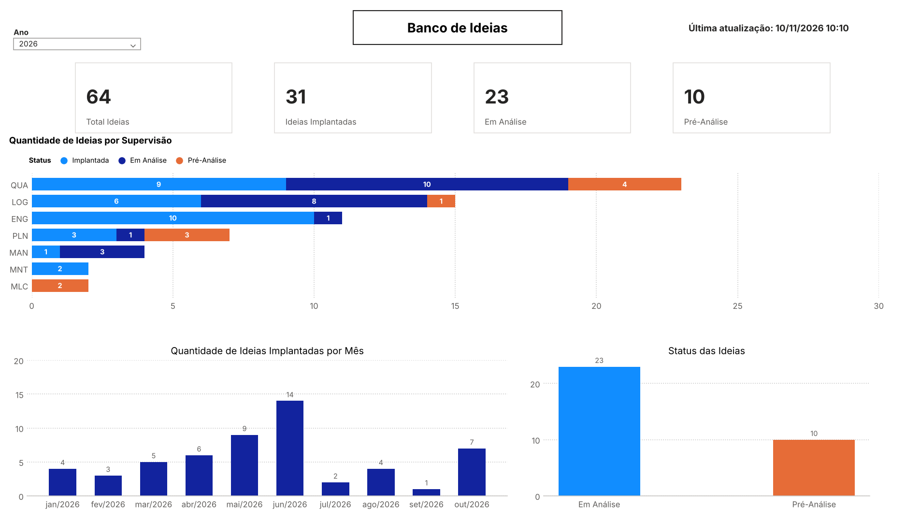

# 📊 Automação de Dashboards de BI para Melhoria Contínua

Trabalho que desenvolvi no estágio de TI na Embraer: sustentação, evolução e automação de três dashboards corporativos em Power BI, usados para acompanhar programas de melhoria contínua.

> 🔒 **Algumas informações foram ocultadas por conta da privacidade da empresa.** Os códigos, as bases de dados e os relatórios originais são internos e não estão neste repositório. As telas abaixo foram recriadas com dados fictícios (nomes, áreas, títulos, IDs e quantidades), mantendo o layout e os indicadores dos painéis reais.

## O problema

Os relatórios dependiam de muita atividade manual para coletar e atualizar dados vindos de fontes diferentes. O objetivo era reduzir esse trabalho, deixar os dados mais confiáveis e ter informação sempre atualizada para a tomada de decisão.

## O que eu fiz

- **Automação em Python** para coletar, tratar e publicar as bases no SharePoint, de onde o Power BI atualiza sozinho
- **Power Query (M)** para leitura das bases, tipagem, limpeza e padronização dos dados
- **Medidas DAX** para os KPIs: status, prazos, vencimentos, aging e implantação
- **Monitoramento de prazos**, com indicadores de itens vencidos e próximos do vencimento
- **Reconstrução completa de um dos BIs** a partir de novas bases, com um modelo mais rápido e mais fácil de manter
- **Sustentação no Power BI Service**: análise e correção de falhas de atualização, credenciais, conectividade e integridade dos dados

## Os três dashboards

### Kaizen
Acompanhamento das iniciativas de melhoria contínua por área, status e tipo. Na automação da coleta, integrei os arquivos do SharePoint, criei as transformações em Power Query e os indicadores em DAX, incluindo o alerta de Kaizens vencidos e próximos do vencimento.



### Chamados (aging)
Acompanhamento de chamados de ações corretivas, com o tempo que cada um está em aberto. Participei da reconstrução completa deste BI a partir de novas bases: reestruturei o modelo, integrei múltiplas fontes, criei as métricas de aging e validei as regras de negócio.



### Banco de Ideias
Programa de ideias enviadas pelos colaboradores. Organizei e padronizei as bases, criei os indicadores e automatizei a atualização para reduzir a intervenção manual.



## Arquitetura

```
Fontes (sistemas, planilhas)
        │
        ▼
Python: coleta → tratamento → publicação
        │
        ▼
SharePoint Online
        │
        ▼
Power BI: Power Query + modelo de dados + DAX
        │
        ▼
Power BI Service (atualização agendada)
```

## Tecnologias

Power BI · Power Query (M) · DAX · Power BI Service · Python · SharePoint Online · Excel

## O que aprendi

Modelagem de dados, ETL, integração entre SharePoint e Power BI, criação de KPIs em DAX e, principalmente, como manter um relatório confiável depois que ele vai para produção: monitorar as atualizações, entender por que uma falhou e corrigir antes que alguém tome decisão com dado errado.
